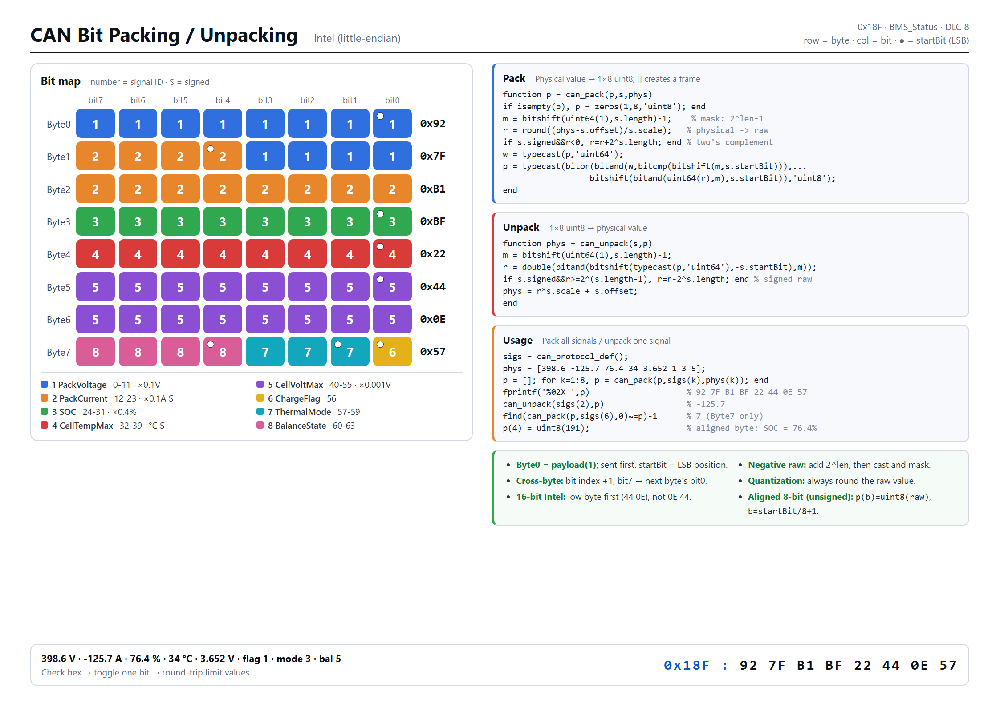

# CAN Cheat Sheet

Printable A4 cheat sheets and MATLAB reference code for **Intel (little-endian) Classic CAN** bit packing and unpacking.

The example covers cross-byte signals, signed two's-complement values, byte-aligned signals, and multiple signals sharing a byte.

## Cheat sheets

- **[English PDF](CAN_CheatSheet_A4_EN.pdf)** · [Preview](CAN_CheatSheet_A4_EN.png) · [Editable HTML](CAN_CheatSheet_A4_EN.html)
- **[Chinese PDF](CAN_CheatSheet_A4.pdf)** · [Preview](CAN_CheatSheet_A4.png)

Print on **A4, landscape, at 100% / actual size**. Both PDFs are single-page vector documents. The sheets contain a bit map, compact pack/unpack functions, usage examples, and key rules; the process block has been removed.



## Quick start

Open this directory in MATLAB and run:

```matlab
can_demo
```

The demo uses a simulated CAN bus; no CAN hardware or additional toolbox is needed. It prints the signal layout, packs and unpacks the reference frame, and checks round trips, boundary values, and a one-bit update.

### Pack and unpack

```matlab
sigs = can_protocol_def();
phys = [398.6 -125.7 76.4 34 3.652 1 3 5];

p = [];
for k = 1:numel(sigs)
    p = can_pack(p, sigs(k), phys(k));
end
fprintf('%02X ', p);
fprintf('\n');
% 92 7F B1 BF 22 44 0E 57

current = can_unpack(sigs(2), p);  % -125.7 A
cellV   = can_unpack(sigs(5), p);  % 3.652 V

p2 = can_pack(p, sigs(6), 0);      % ChargeFlag: 1 -> 0
find(p2 ~= p) - 1                  % 7: only Byte7 changes
% Byte7 changes from 0x57 to 0x56; all other bits are preserved.
```

### Byte-aligned 8-bit signals

If `length == 8` and `mod(startBit, 8) == 0`, no shifting is needed. For the unsigned SOC signal:

```matlab
p(4) = uint8(round(76.4 / 0.4));  % Byte3: raw = 191
soc = double(p(4)) * 0.4;        % 76.4 %
```

For a signed byte, reinterpret its bits with `typecast`, rather than numerically converting a negative value to `uint8`:

```matlab
p(5) = typecast(int8(-34), 'uint8');
temp = double(typecast(p(5), 'int8'));  % -34 degC
```

Validate the raw value's range before using these direct casts. The full `can_pack.m` function performs range checks.

## Reference protocol

**CAN ID:** `0x18F` · **Message:** `BMS_Status` · **DLC:** 8

All signals use Intel byte order. `startBit` is the signal's **LSB position**; `Byte0` is `payload(1)` in MATLAB.

| Signal | startBit | Length | Signed | Scale | Offset | Unit |
|---|---:|---:|:---:|---:|---:|---|
| PackVoltage | 0 | 12 | No | 0.1 | 0 | V |
| PackCurrent | 12 | 12 | Yes | 0.1 | 0 | A |
| SOC | 24 | 8 | No | 0.4 | 0 | % |
| CellTempMax | 32 | 8 | Yes | 1 | 0 | degC |
| CellVoltMax | 40 | 16 | No | 0.001 | 0 | V |
| ChargeFlag | 56 | 1 | No | 1 | 0 | — |
| ThermalMode | 57 | 3 | No | 1 | 0 | — |
| BalanceState | 60 | 4 | No | 1 | 0 | — |

Golden frame for `[398.6 -125.7 76.4 34 3.652 1 3 5]`:

```text
ID 0x18F   DLC 8   Data: 92 7F B1 BF 22 44 0E 57
```

## Reference files

| File | Purpose |
|---|---|
| `can_protocol_def.m` | Signal definitions |
| `can_pack.m` | Physical value -> payload; range checks and an aligned-byte fast path |
| `can_unpack.m` | Payload -> physical value; signed decoding and an aligned-byte fast path |
| `can_layout.m` | Byte-by-bit layout in the MATLAB command window |
| `can_demo.m` | End-to-end example and self-checks |
| `bms_status.dbc` | Matching DBC for external cross-checking |
| `can_bitmap.png` | Rendered 3D bit map |
| `can_bitmap.blend` | Editable Blender bit-map model |

## Implementation notes

- Cross-byte signals use a `uint64` bit container. Packing clears the destination field before OR-ing in the new value, preserving neighboring signals.
- The reference implementation expects an 8-byte `uint8` payload and a little-endian host.
- Physical values are quantized with `round((phys - offset) / scale)`.
- The physical-value API uses `double`; limit field widths to 53 bits for exact integer representation.
- Examples and validation cover **Intel only**. Motorola byte order and CAN FD are outside the scope of this reference.
- Tested with MATLAB R2023b. Optional hardware examples in `can_demo.m` require Vehicle Network Toolbox.
